# M1 — NIGCL Portal | Blue Team Detection Solution

**Status:** All detection/investigation checks completed. Remediation deliberately not applied, as requested.  
**Investigated host:** `mail.labdomain.local`, NIGCL target `192.168.222.130`.  
**Attacker observed in logs:** Kali `192.168.222.128` (with earlier activity shown as `192.168.222.130`).  
**Sources:** `/var/log/nigcl_portal.log`, `journalctl`, `auditd`, and network socket table.  
**Original solution:** https://github.com/hacktifytechnologies/Range4/blob/main/machines/M1-nigcl-portal/solve_blue.md

> This document preserves the order of the official Blue Team guide. Some extra commands were used to make the output easier to capture. Where the original guide's `auditctl` command was invalid, the working syntax is documented. No network shell to M2 was attempted.

## Log Access 

**Commands run on Ubuntu server:**

```bash
sudo tail -f /var/log/nigcl_portal.log
sudo journalctl -u nigcl-portal --since today
```

**Observed:** POST requests to `/inquiry` from Kali `192.168.222.128`, with `curl/8.20.0` and HTTP 200 responses; Gunicorn 23.0.0 listening on port 80 with workers `12425` and `12428`.


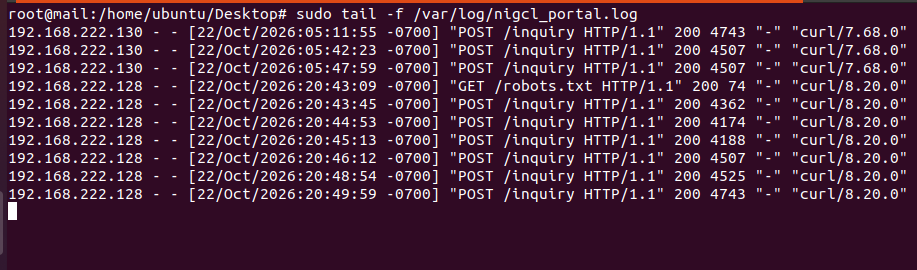

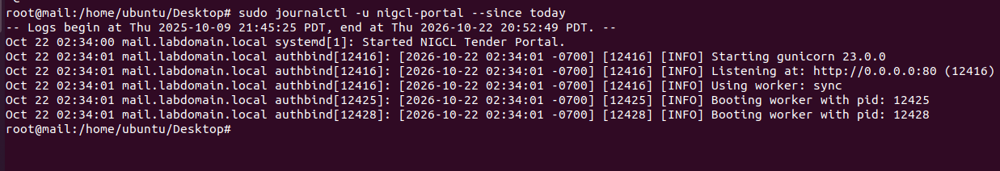

## Detection 1 — SSTI Probe Patterns  (no matches)

```bash
sudo grep -E '%7B%7B|\{\{|cycler|lipsum|__globals__|popen|os\.' /var/log/nigcl_portal.log
```

**Observed:** No lines returned. The inspected log records request method, path, status, and user agent but not the POST body; therefore this negative result **does not** refute the successful SSTI exploitation.


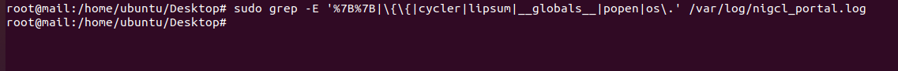

## Detection 2 — RCE Confirmation with auditd 

**Verified existing rule:**

```bash
sudo auditctl -l
# -a always,exit -F arch=b64 -S execve -F uid=33 -F key=www_rce
```

**Note on source guide:** The original command uses invalid `-F syscall=execve`. The valid equivalent is `-F arch=b64 -S execve` along with the UID and key filters. The rule was already installed; attempts to add it again returned `Rule exists`.


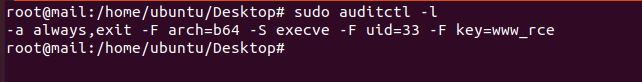

**Search and filter:**

```bash
sudo ausearch -k www_rce --start today -i
sudo ausearch -k www_rce --start today -i \
  | grep -E 'proctitle=/bin/sh|a0=/bin/sh|a0=id|uid=www-data'
```

**Observed October 22, 2026 (PDT):**

| Time | Process / command | Identity and evidence |
| --- | --- | --- |
| 20:46:12 | `/bin/sh -c id` and `id` | `uid=www-data`, `syscall=execve`, `success=yes` |
| 20:48:54 | `cat /opt/nigcl/classified/flag1.txt` | Shell + cat process spawned under `www-data` |
| 20:49:59 | `cat /opt/nigcl/classified/hint.txt` | Shell + cat process spawned under `www-data` |

The shell process's parent was the Gunicorn worker PID `12428`; this provides compelling evidence of unauthorized OS-command execution in the lab. **Execution of `cat` with these filenames is directly logged, but separate file-open auditing was not present.**


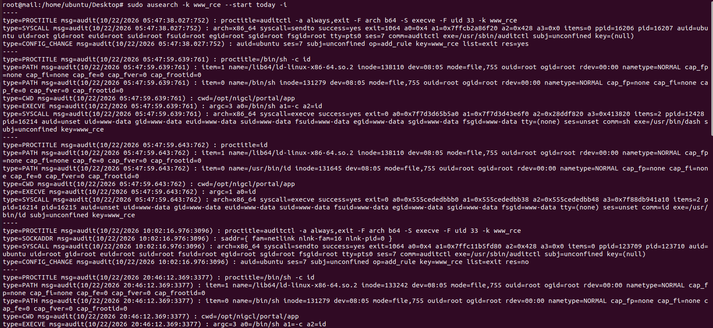

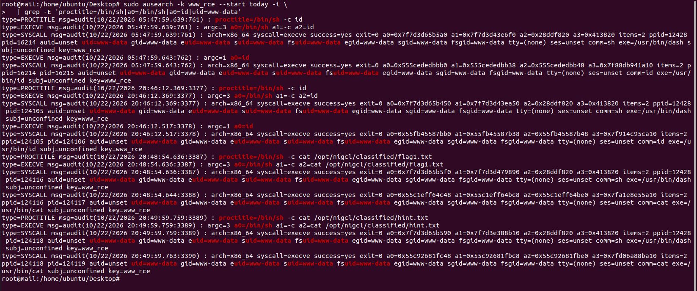

## Detection 3 — Flag / Hint File Access  (no file-access records)

```bash
sudo ausearch --start today -f /opt/nigcl/classified/flag1.txt
sudo ausearch --start today -f /opt/nigcl/classified/hint.txt
```

**Observed:** Both yielded `<no matches>`. The current rule audits `execve` and does not necessarily log each file read. However, command execution audit records in Detection 2 show that `cat` was invoked with both file paths.


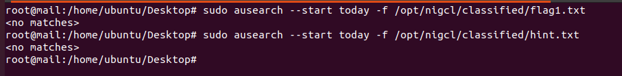

## Detection 4 — HTTP 500 Error Spike  (zero)

The official guide discusses bursts of HTTP 500 responses on `/inquiry`. To test this, the following supporting commands were used:

```bash
sudo grep 'POST /inquiry' /var/log/nigcl_portal.log | grep '" 500 '
sudo awk '$7=="/inquiry" && $9==500 {count++} END {print "HTTP 500 errors:", count+0}' /var/log/nigcl_portal.log
```

**Observed:** `HTTP 500 errors: 0`. Error messages were displayed in application responses that still used HTTP 200, so HTTP-500-based detection is not sufficient for this deployment.


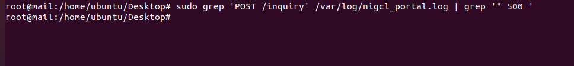

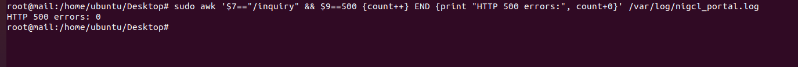

## Detection 5 — Outbound Connection from www-data  (none currently visible)

```bash
sudo ss -tp | grep www-data
```

**Observed:** No matching connections at inspection time. Reverse shell was deliberately deferred, so no shell connection was expected. This snapshot does not rule out previous connections.


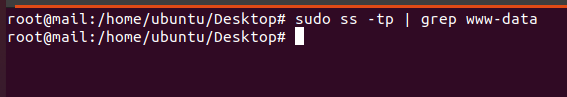

## Remediation — Not Performed (by request) 

The source solution recommends replacing unsafe `render_template_string()` with fixed-template `render_template()`, sandboxing where dynamic templates cannot be avoided, input allowlisting, WAF defenses, and least-privilege system confinement. **No remediation was applied in this exercise.**

As supplementary investigation, the vulnerable source was identified as `/opt/nigcl/portal/app/app.py`, line 83: `output = render_template_string(tpl)`. Lines 70–83 concatenate `product_query` into the template source after applying a weak substring blacklist.


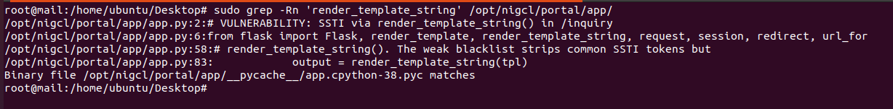

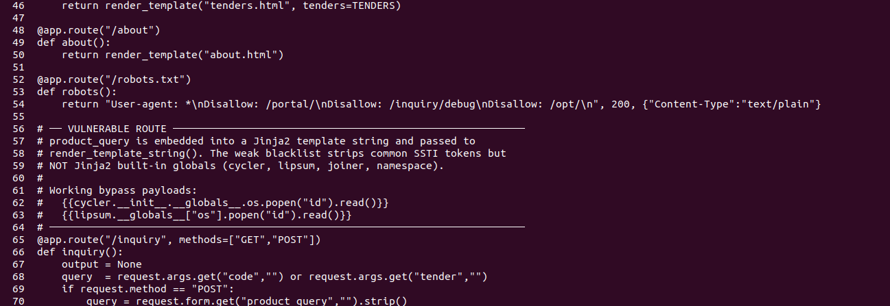

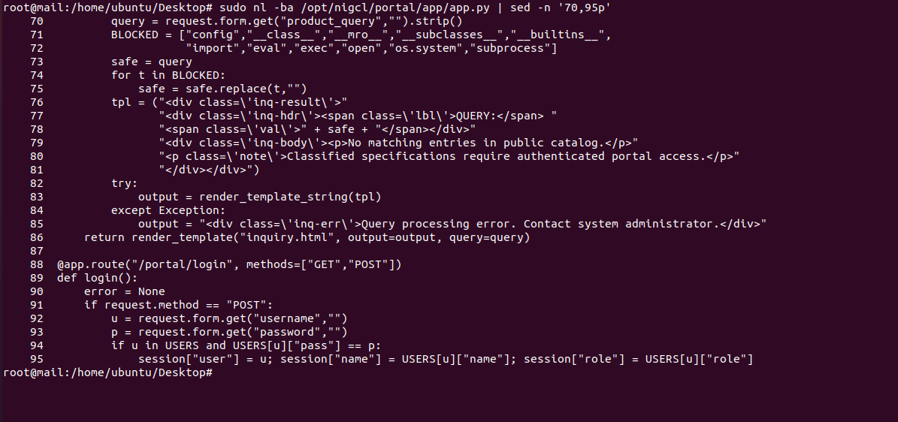


## Detection Conclusion

Repeated `/inquiry` requests were observed; payload-text matching was unavailable because POST bodies were not logged. Auditd conclusively captured the execution of `id` and `cat` as `www-data` and provided the strongest evidence. Independent file-access auditing, HTTP 500 analysis, and active socket checks returned no matching evidence. Remediation remains outstanding.
