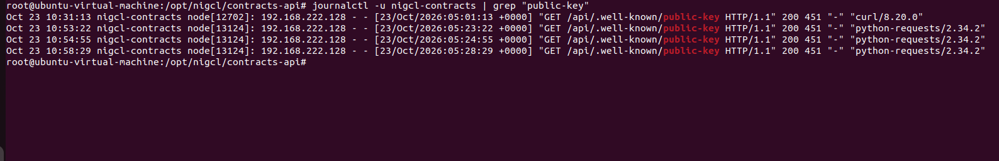
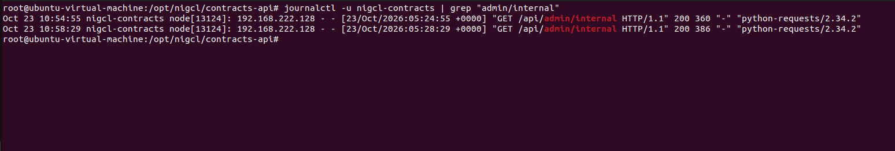
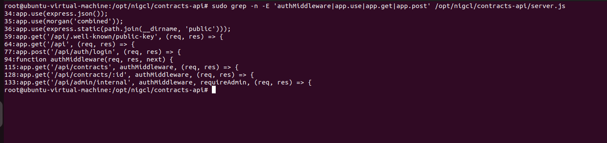
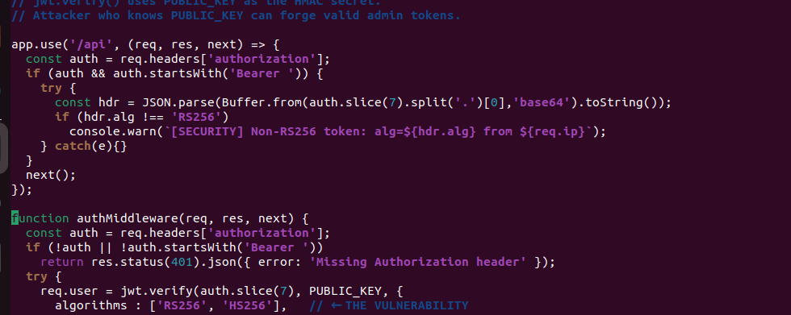
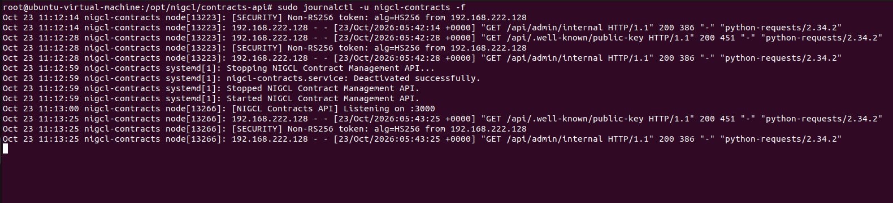
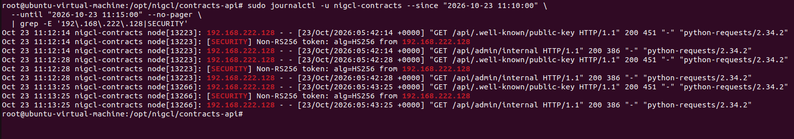
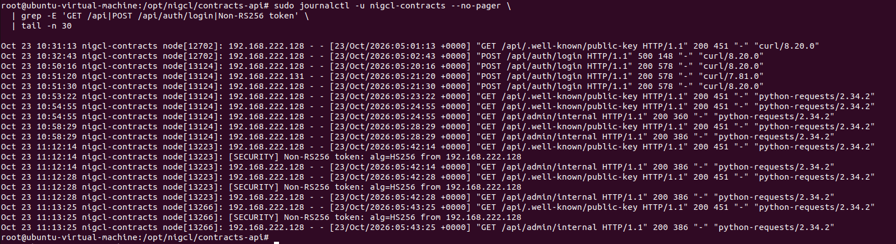
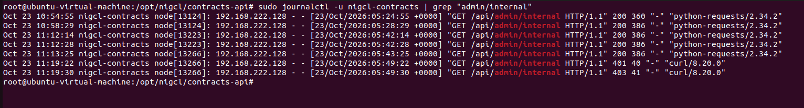

# Blue Team — M2: NIGCL Contracts Detection Guide

**Monitored VM:** Ubuntu 22.04, `192.168.222.131`  
**Red Team source:** Kali `192.168.222.128`  
**Log source:** `journalctl -u nigcl-contracts`  
**Vulnerability:** JWT RS256 → HS256 algorithm confusion  
**Original reference:** https://github.com/hacktifytechnologies/Range4/blob/main/machines/M2-nigcl-contracts/solve_blue.md

> This document follows the four detection checks in the official writeup, then records remediation as deferred. All screenshots were supplied during the lab exercise. The extra log filters and code-location checks are investigative aids rather than verbatim original commands.

## Detection 1 — Public Key Endpoint Access

```bash
journalctl -u nigcl-contracts | grep 'public-key'
```

**Observed:** Repeated HTTP 200 requests to `/api/.well-known/public-key` from `192.168.222.128`, including entries at 10:31:13, 10:53:22, 10:54:55, and 10:58:29 IST on October 23, 2026. The same source subsequently reached `/api/admin/internal` with 200 responses.



*Figure: Service journal recording exposed public key retrievals.*


*Figure: Protected administrator endpoint HTTP 200 events.*

## Detection 2 — HS256 Token Detection

The official solution adds the following logging middleware to `server.js` before `authMiddleware`. In this deployment, the auth function begins around line 94, ahead of protected `/api/contracts` and `/api/admin/internal` routes.

```bash
sudo grep -n -E 'authMiddleware|app.use|app.get|app.post' /opt/nigcl/contracts-api/server.js
sudo cp /opt/nigcl/contracts-api/server.js /opt/nigcl/contracts-api/server.js.bak
sudo nano /opt/nigcl/contracts-api/server.js
```

```javascript
app.use('/api', (req, res, next) => {
  const auth = req.headers['authorization'];
  if (auth && auth.startsWith('Bearer ')) {
    try {
      const hdr = JSON.parse(Buffer.from(auth.slice(7).split('.')[0],'base64').toString());
      if (hdr.alg !== 'RS256')
        console.warn(`[SECURITY] Non-RS256 token: alg=${hdr.alg} from ${req.ip}`);
    } catch(e){}
  }
  next();
});
```

**Validation and reproduction:**

```bash
node --check /opt/nigcl/contracts-api/server.js
sudo systemctl restart nigcl-contracts
sudo journalctl -u nigcl-contracts -f
```

From Kali, we reran `python3 m2_jwt_exploit.py`. **Observed security event:**

```text
[SECURITY] Non-RS256 token: alg=HS256 from 192.168.222.128
GET /api/admin/internal HTTP/1.1 200
```

The middleware detected but did not block the suspicious algorithm. It was placed before `authMiddleware`; the existing vulnerable acceptance of `['RS256','HS256']` remained unchanged.



*Figure: Relevant server.js middleware and route locations.*


*Figure: HS256 detection middleware inserted before authMiddleware.*


*Figure: Live security log of accepted HS256 admin JWT from Kali.*

## Detection 3 — Attack Timeline (same IP within five minutes)

The original guide's target sequence is: API enumeration → public key access → optional vendor login → forged HS256 admin endpoint HTTP 200. Actual requests from the logs include the following:

```bash
sudo journalctl -u nigcl-contracts --since '2026-10-23 11:10:00' \
  --until '2026-10-23 11:15:00' --no-pager \
  | grep -E '192\.168\.222\.128|SECURITY'

sudo journalctl -u nigcl-contracts --no-pager \
  | grep -E 'GET /api|POST /api/auth/login|Non-RS256 token' | tail -n 30
```

**Recorded sequence (IST):**

| Time | Event | Result |
|---|---|---|
| 10:31:13 | Public key request | 200 |
| 10:32:43 | Vendor login (before OpenSSL runtime fix) | 500 |
| 10:50:16 | Vendor login after compatibility fix | 200 |
| 10:54:55 | Public key request, then forged admin request | 200 / 200 |
| 10:58:29 | Public key request, then forged admin request | 200 / 200 |
| 11:12:14 | Public key retrieval, HS256 warning, admin access | 200 / warning / 200 |
| 11:12:28 | Repeat HS256 warning and admin access | warning / 200 |
| 11:13:25 | Repeat public key retrieval, HS256 warning, admin access | 200 / warning / 200 |

No separate `GET /api` enumeration log was supplied, so the exact four-event theoretical sequence should not be claimed as fully observed.



*Figure: Focused timestamped HS256 attack sequence.*


*Figure: Extended journal showing key retrieval, vendor login and admin requests.*

## Detection 4 — Admin 403 → 200 Transition

The official guide uses:

```bash
journalctl -u nigcl-contracts | grep 'admin/internal'
```

**Actual logs:** The forged administrator calls yielded HTTP `200` at 10:54, 10:58, 11:12, and 11:13 IST. The later negative control requests yielded HTTP `401` at 11:19:22 and `403` at 11:19:30. Thus **both 403 and 200 were observed, but the screenshot's chronological order is 200 → 403, not 403 → 200**.

A fresh successful forged request after the 403 could demonstrate the chronological 403 → 200 transition, but this subsequent screenshot was not provided.



*Figure: Admin endpoint results showing earlier HTTP 200 and later HTTP 401/403.*


## Remediation — DEFERRED

The original solution lists the following remediation themes: accept only RS256 for verification, stop exposing the key as an unrestricted API response, manage signing keys with rotation/JWKS, and validate token algorithms explicitly. No final remediation patch was applied because the intentionally vulnerable cyber-range challenge is being retained for future exercises.


## Blue Team conclusion

The log record links public-key retrieval to HS256 JWT use from Kali `192.168.222.128` and a successful protected endpoint response on M2 `192.168.222.131`. Detection middleware generates security warnings; it does **not** independently block the attack. The deployed VM should have a known-good snapshot preserving installation runtime fixes, flag permissions, and the detection-only changes.
