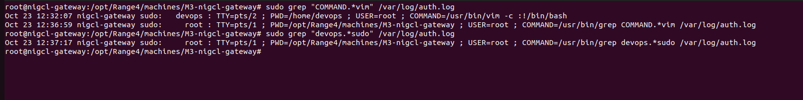
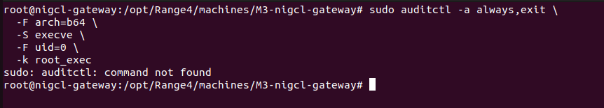
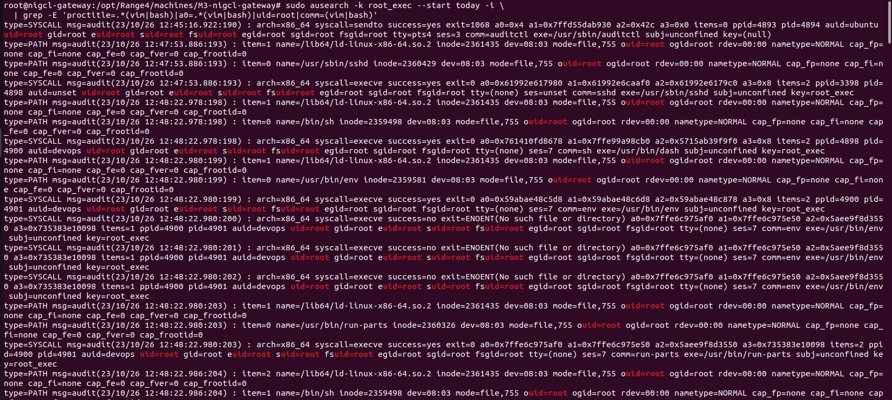
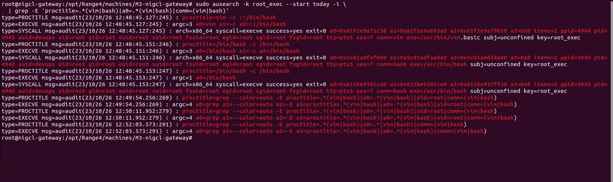
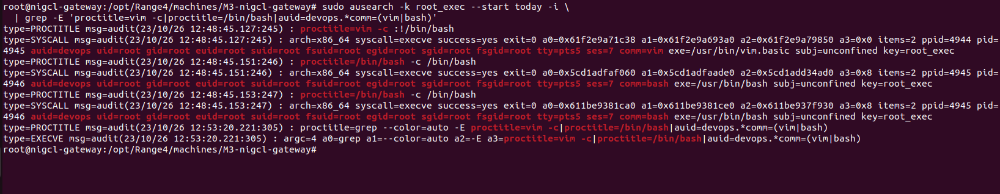

# M3 NIGCL Gateway — Blue Team Solution

**Range4 | Machine:** `M3-nigcl-gateway`  
**Source:** [Official solve_blue.md](https://github.com/hacktifytechnologies/Range4/blob/main/machines/M3-nigcl-gateway/solve_blue.md)  
**Server:** `192.168.222.132` | **OS:** Ubuntu 22.04.5 LTS  
**Log sources:** `/var/log/auth.log`, auditd execution events  
**Execution date:** 23 October 2026

> This report preserves the official detection order. We corrected one invalid upstream `auditctl` option to `-S execve` and installed auditd because the cloned Ubuntu VM initially lacked the utility. Remediation is deferred to preserve the lab.

## Step 1 — Detect sudo Vim invocation

Commands from the official solution:

```bash
sudo grep 'COMMAND.*vim' /var/log/auth.log
sudo grep 'devops.*sudo' /var/log/auth.log
```

**Observed critical event:**

```text
Oct 23 12:32:07 nigcl-gateway sudo: devops : TTY=pts/2 ; PWD=/home/devops ; USER=root ; COMMAND=/usr/bin/vim -c :!/bin/bash
```

This is the sudo event for the Red Team shell escape. Other grep commands run by the defender also appear in the log and should not be confused with the original attack.



## Step 2 — Monitor process execution as root (auditd)

The original writeup uses `-F syscall=execve`, which is not a valid `auditctl` field. On this VM, `auditctl` was initially unavailable:



After installing and enabling `auditd`, create the corrected monitoring rule:

```bash
sudo apt update
sudo apt install -y auditd audispd-plugins
sudo systemctl enable --now auditd
sudo auditctl -a always,exit -F arch=b64 -S execve -F uid=0 -k root_exec
sudo auditctl -l
```

**Note:** These audit events capture only execution after monitoring is active, so the lab's Vim escalation was repeated after creating the rule.

Search the execution events:

```bash
sudo ausearch -k root_exec --start today -i
sudo ausearch -k root_exec --start today -i | grep -E 'proctitle=.*(vim|bash)|a0=.*(vim|bash)|comm=(vim|bash)'
```

**Observed:** successful root process execution, including the Vim and Bash entries. The broader result also includes unrelated root processes such as `sshd` and `run-parts`.





## Step 3 — Verify the privilege escalation indicators

For a concise IOC-focused screenshot:

```bash
sudo ausearch -k root_exec --start today -i   | grep -E 'proctitle=vim -c|proctitle=/bin/bash|auid=devops.*comm=(vim|bash)'
```

**Observed on October 23, 2026 at 12:48:45 (server-local time):**

```text
proctitle=vim -c :!/bin/bash
auid=devops uid=root euid=root comm=vim
proctitle=/bin/bash -c /bin/bash
auid=devops uid=root euid=root comm=bash
syscall=execve success=yes key=root_exec
```

The audit identity `auid=devops` alongside the privileged process `uid=root` links the root shell to the user session. This, together with `/var/log/auth.log`, is strong evidence of the `sudo → vim → bash` escalation.



### Sensitive-file access indicator

The upstream guide also lists root reading `/root/secrets.txt` shortly after escalation. The Red Team session screenshot confirms that command occurred, but no dedicated **file-open** audit record was collected during the Blue Team session. Do not present the `execve` audit output as proof of a monitored file read.


## Remediation (deferred)

The official guide recommends removing the vulnerable sudoers rule, using `sudoedit` for tightly scoped edits, narrowing access to specific files and roles, and periodically reviewing `sudo -l` permissions across accounts.

**Status:** Not implemented, to keep M3 available for repeatable cyber-range exercises.


## Blue Team outcome

- `devops`'s `sudo vim` invocation in `/var/log/auth.log`: **confirmed**.
- Root process execution in auditd: **confirmed**.
- Vim-to-Bash shell escape linked to `auid=devops`: **confirmed**.
- Independent secrets-file read auditing: **not captured**.
- Remediation: **deferred**.
