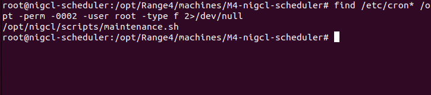
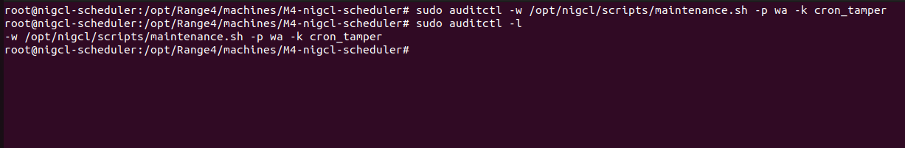
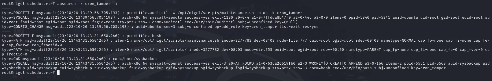
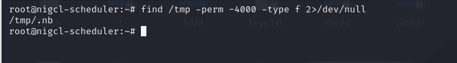
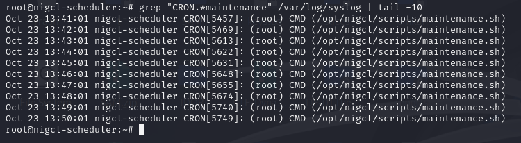
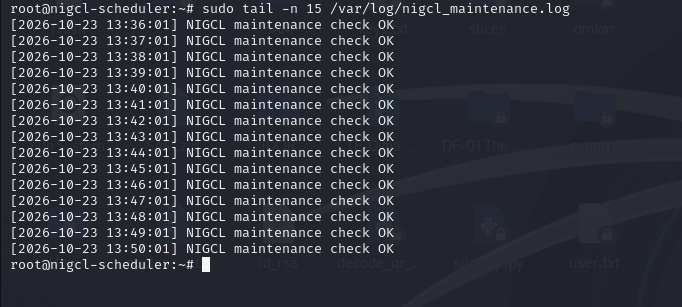

# Blue Team — M4: nigcl-scheduler

**Monitored host:** `192.168.222.133`  
**Attack source:** Kali Linux (`192.168.222.128`)  
**Log sources:** `/var/log/syslog`, `/var/log/nigcl_maintenance.log`, auditd  
**Source:** [Official M4 Blue Team solution](https://github.com/hacktifytechnologies/Range4/blob/main/machines/M4-nigcl-scheduler/solve_blue.md)

> The evidence follows the official four detection steps. The auditd rule was installed after the original exploit, so a separate harmless comment append was used to demonstrate file-write attribution. This later event is not the original exploit write.

## Step 1 — Find world-writable root-owned cron scripts

```bash
find /etc/cron* /opt -perm -0002 -user root -type f 2>/dev/null
```

Found: `/opt/nigcl/scripts/maintenance.sh`.



*Evidence: Root-owned writable maintenance script detected.*

## Step 2 — Monitor script modification using auditd

Auditd was not originally installed on M4. After installing and enabling it, the following official rule was added:

```bash
sudo auditctl -w /opt/nigcl/scripts/maintenance.sh -p wa -k cron_tamper
sudo auditctl -l
```



*Evidence: Auditd cron_tamper watch installed.*

After enabling the watch, the `sysbackup` user appended a harmless comment:

```bash
echo '# Auditd monitoring verification' >> /opt/nigcl/scripts/maintenance.sh
```

Investigation:

```bash
sudo ausearch -k cron_tamper -i
```

Observed `syscall=openat`, `success=yes`, `auid=sysbackup`, `uid=sysbackup`, and the monitored script path. This proves auditd can attribute subsequent writes.



*Evidence: Auditd event proves write by sysbackup.*

## Step 3 — Search for SUID executables in /tmp

The official writeup uses `find /tmp -perm /4000 2>/dev/null`; the lab used the equivalent SUID-file filter with a file-type constraint:

```bash
find /tmp -perm -4000 -type f 2>/dev/null
```

Found `/tmp/.nb`, the SUID Bash binary established during the Red Team phase.



*Evidence: Suspicious SUID binary found in /tmp.*

## Step 4 — Review recurring root cron execution

```bash
grep "CRON.*maintenance" /var/log/syslog | tail -10
```

Observed `(root) CMD (/opt/nigcl/scripts/maintenance.sh)` every minute, including 13:48–13:50 on 23 October 2026.



*Evidence: Cron runs maintenance script as root every minute.*

Additional corroboration:

```bash
sudo tail -n 15 /var/log/nigcl_maintenance.log
```

The maintenance log shows successful periodic checks; it does not itself identify the injected command.



*Evidence: Maintenance check log corroborates scheduled execution.*

## Remediation (deferred)

The official solution recommends:

- `chmod 755 /opt/nigcl/scripts/maintenance.sh`
- Auditing root-owned world-writable files
- Deploying AIDE/Tripwire for cron script integrity
- Watching scripts within `/opt/nigcl/scripts/` with auditd


Remediation was intentionally deferred to keep the vulnerable exercise available. For reuse, restore the clean `M4-NIGCL-Scheduler-Working` snapshot rather than retaining the compromised environment.

## Detection conclusion

Combined indicators: writable root cron script, audited change from `sysbackup`, unexpected SUID Bash under `/tmp`, and recurring cron execution as root. The evidence supports the observed cron-based privilege-escalation chain.
