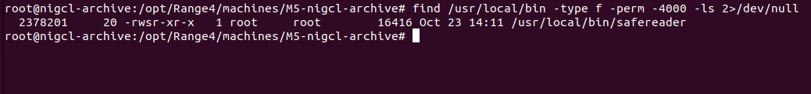
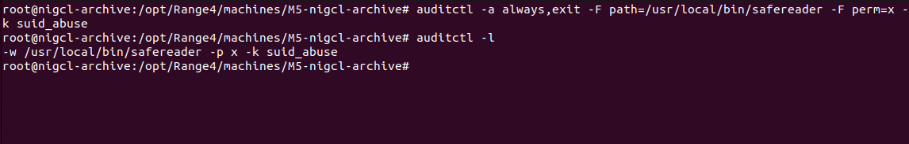
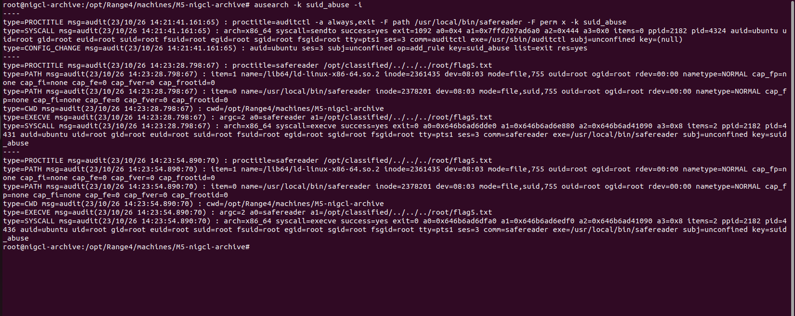
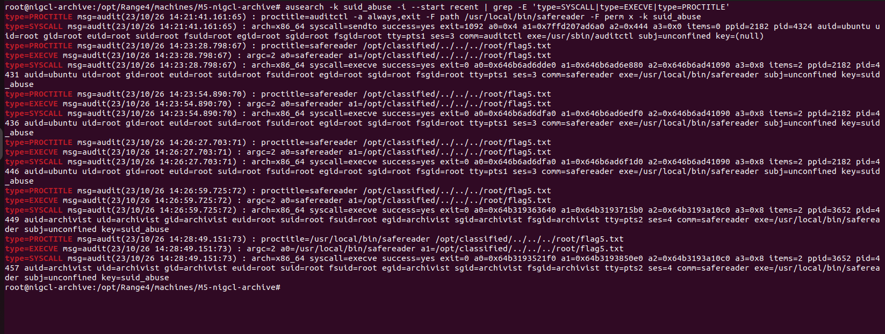
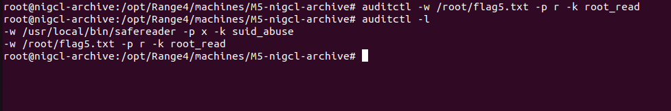
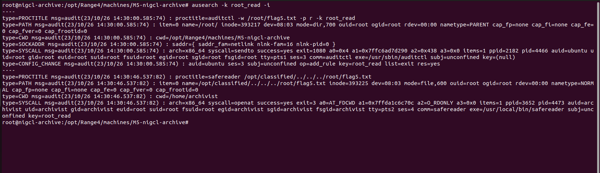

# M5 NIGCL Archive — Blue Team Investigation

**Defender host:** `nigcl-archive` (`192.168.222.134`), Ubuntu 22.04.5.  
**Sources:** auditd execution monitoring, sensitive file read monitoring, local filesystem SUID inventory.  
**Status:** Defensive investigation complete; remediation deferred to preserve the lab.

## 1. Inventory non-standard SUID executables

Repository baseline recommends broad inventory:

```bash
find / -perm -4000 -type f 2>/dev/null | sort
```

**Executed scoped inventory:**

```bash
find /usr/local/bin -type f -perm -4000 -ls 2>/dev/null
```

**Observed:** `/usr/local/bin/safereader` is root-owned and SUID (`-rwsr-xr-x`). The full-host inventory command from the reference was **not** executed; the scoped command identified the relevant file.



*Evidence: `M5-BLUE-01-SUID-Binary-Discovery.png`*

## 2. Install auditd execution monitoring

```bash
auditctl -a always,exit -F path=/usr/local/bin/safereader -F perm=x -k suid_abuse
auditctl -l
```

**Observed audit rule:** `-w /usr/local/bin/safereader -p x -k suid_abuse`.



*Evidence: `M5-BLUE-02A-Auditd-Rule-Configured.png`*

## 3. Detect traversal executions and attribute user

```bash
ausearch -k suid_abuse -i
ausearch -k suid_abuse -i --start recent | grep -E 'type=SYSCALL|type=EXECVE|type=PROCTITLE'
```

**Observed:** Successful `execve` of `/usr/local/bin/safereader` with argument `/opt/classified/../../../root/flag5.txt`.

**Attribution caution:** Initial events at 14:23:28 and 14:23:54 were run from the **Ubuntu root console** (`auid=ubuntu uid=root euid=root`), and should not be attributed to the attacker. Later events at 14:26:59 and 14:28:49 show `auid=archivist uid=archivist euid=root` with `key=suid_abuse`, demonstrating the SUID elevation during invocation by the unprivileged account.



*Evidence: `M5-BLUE-02B-SUID-Execution-Detected.png`*



*Evidence: `M5-BLUE-02C-Initial-Audit-Review.png`*

## 4. Monitor protected file reads

```bash
auditctl -w /root/flag5.txt -p r -k root_read
auditctl -l
```

**Observed rule:** `-w /root/flag5.txt -p r -k root_read` alongside existing `suid_abuse` watch.



*Evidence: `M5-BLUE-03A-Sensitive-File-Monitoring.png`*

## 5. Correlate an actual file read from archivist

After installing the watch, the controlled attacker traversal was repeated:

```bash
# Kali SSH session as archivist
safereader "/opt/classified/../../../root/flag5.txt"
# M5 root console
ausearch -k root_read -i
```

**Observed at 2026-10-23 14:30:46:** Audit `openat` succeeded (`success=yes`) for `name=/opt/classified/../../../root/flag5.txt`; `a2=O_RDONLY`; `auid=archivist uid=archivist euid=root`; `comm=safereader`, `exe=/usr/local/bin/safereader`, `key=root_read`. This is direct evidence of a protected file read, rather than merely program execution.



*Evidence: `M5-BLUE-03B-Sensitive-File-Read-Detected.png`*

## Investigation finding

**Confirmed attack chain:** a non-root user (`archivist`) invoked a root-owned SUID utility with directory traversal; auditd shows elevated effective UID and a successful `O_RDONLY` open of a root-protected path. No evidence suggests that this granted an interactive root shell; the confirmed privilege abuse is unauthorized file reading.

## Remediation — documented, not applied

The upstream Blue Team guide recommends canonicalizing requested file paths (`realpath()`), enforcing the approved directory boundary properly (including separator/boundary safety), and considering removal of SUID in favor of a least-privilege service design. Remediation is **deferred** because the intentionally vulnerable exercise should remain reproducible.

> Implementation note: simple `strncmp` with no directory-boundary validation is not a complete secure path policy. Production code should also account for symlinks, races, and permitted directory boundaries.

## Evidence limitations

- The canonical broad SUID inventory (`find / ...`) was not captured; a narrower equivalent targeted the relevant executable.
- Some earlier audit events were generated as `root` and should not be misattributed to `archivist`.
- Audit rules added interactively may not survive reboot unless persisted using auditd rules configuration.
- No remediation test was performed.

## Source

- https://github.com/hacktifytechnologies/Range4/blob/main/machines/M5-nigcl-archive/solve_blue.md
